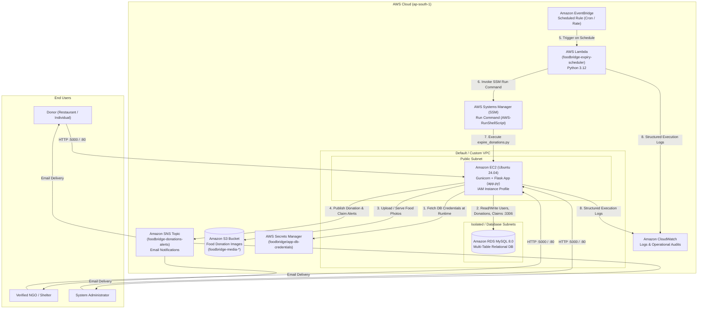

# FoodBridge — Cloud-Native Food Surplus & Donation Management Platform

FoodBridge is a cloud-native web application built for the **Cloud Computing Lab (CCL)** that eliminates food waste by connecting surplus food donors (restaurants, caterers, hostels, and individuals) with verified NGOs and shelters in real time.

It demonstrates a production-grade **AWS Cloud Architecture** utilizing **Infrastructure as Code (Terraform)**, **Managed Relational Databases (Amazon RDS MySQL)**, **Dynamic Secret Resolution (AWS Secrets Manager)**, **Object Storage (Amazon S3)**, **Pub/Sub Messaging (Amazon SNS)**, **Serverless Scheduled Automation (AWS Lambda + Amazon EventBridge)**, and **Keyless Operations (AWS Systems Manager)**.

---

## Table of Contents

1. [System Architecture & Data Flow](#1-system-architecture--data-flow)
2. [Detailed Component Explanation](#2-detailed-component-explanation)
3. [Repository & Codebase Structure](#3-repository--codebase-structure)
4. [Database Schema & Role Workflows](#4-database-schema--role-workflows)
5. [Step-by-Step Instructions to Run](#5-step-by-step-instructions-to-run)
6. [Complete Commands Reference](#6-complete-commands-reference)
7. [Automated Verification & Test Suites](#7-automated-verification--test-suites)
8. [Security & Zero-Secret Compliance](#8-security--zero-secret-compliance)

---

## 1. System Architecture & Data Flow



### Architectural Flow Summary
1. **User Interaction**: Donors, NGOs, and Admins interact with the Flask web application hosted on an **Amazon EC2** instance.
2. **Dynamic Credential Injection**: On startup, the Flask application (`app.py`) and operational scripts (`scripts/get_rds_credentials.py`) query **AWS Secrets Manager** using the EC2 IAM Instance Profile to retrieve RDS MySQL connection parameters in memory—zero credentials are stored on disk or in Git.
3. **Persistent Data Layer**: User accounts, donation listings, claim records, and lifecycle states (`AVAILABLE`, `CLAIMED`, `PICKED_UP`, `EXPIRED`) are stored in **Amazon RDS (MySQL 8.0)** protected by a dedicated RDS Security Group that only permits port `3306` traffic from the EC2 Security Group.
4. **Media Offloading**: Food donation photos uploaded by donors are stored in **Amazon S3** (`uploads/donations/*`) and served via public/presigned object URLs, keeping the compute tier stateless.
5. **Real-Time Event Notifications**: Whenever a new donation is posted, claimed by an NGO, or marked as expired, the application publishes structured alerts to **Amazon SNS**, which dispatches email notifications to subscribed stakeholders.
6. **Serverless Expiry Automation**: **Amazon EventBridge** triggers an **AWS Lambda** function (`foodbridge-expiry-scheduler`) on a schedule. The Lambda function invokes `expire_donations.py` on the EC2 instance via **AWS Systems Manager (SSM) Run Command**, transitioning past-due `AVAILABLE` donations to `EXPIRED` and sending summary notifications via SNS.

---

## 2. Detailed Component Explanation

| Component | Technology / AWS Service | Purpose & Implementation Details |
| :--- | :--- | :--- |
| **Application Tier** | Python 3, Flask, Jinja2, Gunicorn (`app.py`) | Implements MVC routing, session authentication (` werkzeug.security` password hashing), role-based access control (`donor`, `ngo`, `admin`), dual-database driver abstraction (SQLite for local dev, `pymysql` for AWS RDS MySQL), S3 upload integration, and fault-tolerant SNS publishing. |
| **Compute Tier** | Amazon EC2 (`infrastructure/terraform-ec2`) | Ubuntu 24.04 LTS instance (`t3.micro`) provisioned via Terraform with encrypted gp3 EBS root volume, IMDSv2 enforced (`http_tokens = required`), and an attached IAM Instance Profile for keyless AWS API access. |
| **Database Tier** | Amazon RDS MySQL 8.0 (`infrastructure/terraform-rds`) | Managed MySQL 8.0 (`db.t3.micro`) instance deployed in a DB Subnet Group with encrypted storage, automated backups, and strict security group ingress allowing port `3306` exclusively from the EC2 instance SG. |
| **Secrets Management** | AWS Secrets Manager (`scripts/get_rds_credentials.py`) | Stores RDS master/application credentials (`foodbridge/app-db-credentials`) generated with `random_password` in Terraform. Retrieved dynamically at runtime via `boto3.client('secretsmanager')`. |
| **Object Storage** | Amazon S3 (`scripts/upload_images_to_s3.py`) | Stores uploaded food donation images in `s3://<bucket>/uploads/donations/<filename>`. Eliminates local disk state on EC2 and supports seamless horizontal scaling. |
| **Notification Service** | Amazon SNS (`app.py` / `publish_sns_notification`) | Dispatches real-time email alerts for three critical lifecycle events: New Donation Created, Donation Claimed by NGO, and Automated Donation Expiration. |
| **Serverless Scheduler** | AWS Lambda + EventBridge (`infrastructure/lambda/lambda_function.py`) | Python 3.12 Lambda function triggered by EventBridge rules. Dispatches remote execution commands via SSM (`ssm:SendCommand`) and polls command invocation results (`ssm:GetCommandInvocation`) with structured CloudWatch telemetry. |
| **Remote Management** | AWS Systems Manager (SSM) | Replaces SSH keys and bastion hosts. Used for zero-touch deployments (`scripts/deploy_step17c.py`, `scripts/deploy_step18b.py`) and Lambda-triggered cron jobs. |
| **Infrastructure as Code** | Terraform (`infrastructure/terraform-*`) | Modular Terraform configurations managing VPC networking, Security Groups, EC2 compute, RDS MySQL, Subnet Groups, and Secrets Manager resources. |

---

## 3. Repository & Codebase Structure

```text
Foodbridge/
├── app.py                                      # Core Flask web application (Routes, Auth, RDS/SQLite DB layer, S3 & SNS integration)
├── requirements.txt                            # Python dependencies (Flask, boto3, pymysql, werkzeug, etc.)
├── .gitignore                                  # Excludes .env, *.db, *.tfstate, *.tfvars, keys, and local uploads
├── step19h_lambda_response.json                # Sample verified output payload from AWS Lambda expiry execution
├── static/
│   ├── css/style.css                           # Responsive UI stylesheet
│   └── uploads/.gitkeep                        # Local upload fallback directory
├── templates/                                  # Jinja2 HTML views
│   ├── index.html                              # Landing page with live platform impact statistics
│   ├── register.html                           # Multi-role registration (Donor / NGO)
│   ├── login.html                              # Authentication portal
│   ├── donor_dashboard.html                    # Donor portal: track posted donations, status, and claiming NGO
│   ├── add_donation.html                       # Form to post surplus food with category, expiry time, and photo upload
│   ├── ngo_dashboard.html                      # NGO portal: browse available food, one-click claim, mark picked up
│   └── admin_dashboard.html                    # Admin portal: full system audit across users, donations, and claims
├── infrastructure/
│   ├── lambda/
│   │   ├── lambda_function.py                  # Production AWS Lambda handler triggering SSM expiry automation
│   │   └── backup_dry_run/                     # Dry-run Lambda package and configuration reference
│   ├── terraform-ec2/                          # Terraform module for EC2 instance, Security Group, and User Data
│   │   ├── main.tf                             # EC2 instance and SG resource definitions
│   │   ├── variables.tf                        # Configurable region, instance type, VPC/subnet variables
│   │   ├── outputs.tf                          # Exported EC2 Instance ID, Public IP, and SG ID
│   │   ├── user_data.sh                        # Bootstrap script installing Python, systemd service, and dependencies
│   │   └── terraform.tfvars.example            # Template variable file (no secrets)
│   ├── terraform-rds/                          # Terraform module for RDS MySQL, DB Subnet Group, and Secrets Manager
│   │   ├── main.tf                             # RDS instance, random_password, and Secrets Manager secret
│   │   ├── variables.tf                        # DB engine, storage, and networking variables
│   │   ├── outputs.tf                          # RDS endpoint, port, and Secret ARN outputs
│   │   └── README.md                           # RDS module specific documentation
│   └── terraform/                              # Full-stack VPC + EC2 + Security reference Terraform module
└── scripts/
    ├── get_rds_credentials.py                  # Helper module to fetch & parse RDS credentials from Secrets Manager
    ├── expire_donations.py                     # CLI/Automated script to expire overdue donations (--dry-run / --apply)
    ├── migrate_sqlite_to_mysql.py              # Database migration utility (SQLite -> AWS RDS MySQL)
    ├── upload_images_to_s3.py                  # Batch migrates local food images to Amazon S3
    ├── deploy_app.sh / deploy_app.ps1          # Automated deployment scripts for Linux and Windows
    ├── deploy_step17c.py / deploy_step18b.py   # Keyless AWS SSM deployment automation scripts
    └── test_*_suite.py / verify_*.py           # Comprehensive unit, integration, and production verification suites
```

---

## 4. Database Schema & Role Workflows

### Relational Schema (`users` & `donations`)

1. **`users` Table**:
   - `id` (Primary Key, Auto Increment)
   - `name` (VARCHAR) — Full name of individual, restaurant, or NGO
   - `email` (VARCHAR, UNIQUE) — Login identifier
   - `password` (VARCHAR) — PBKDF2/Scrypt hashed password
   - `phone` (VARCHAR) — Contact number for pickup coordination
   - `role` (VARCHAR) — `donor`, `ngo`, or `admin`
   - `organization` (VARCHAR) — Organization/Restaurant/NGO name
   - `address` (TEXT) — Physical address
   - `created_at` (TIMESTAMP)

2. **`donations` Table**:
   - `id` (Primary Key, Auto Increment)
   - `donor_id` (Foreign Key -> `users.id`)
   - `food_name` (VARCHAR) — Title/description of surplus food
   - `category` (VARCHAR) — Cooked Food, Raw Ingredients, Packaged Food, Bakery, Fruits/Vegetables
   - `quantity` (VARCHAR) — Servings or weight (e.g., `40 servings`, `15 kg`)
   - `pickup_address` (TEXT) — Location for NGO collection
   - `available_until` (VARCHAR / ISO Datetime) — Expiration timestamp (IST)
   - `notes` (TEXT) — Allergen or packaging notes
   - `image_filename` (VARCHAR) — Filename resolved against S3 (`S3_BASE_URL`) or local uploads
   - `status` (VARCHAR) — Lifecycle state: `AVAILABLE` -> `CLAIMED` -> `PICKED_UP` (or `EXPIRED`)
   - `claimed_by` (Foreign Key -> `users.id`, Nullable) — NGO user ID that claimed the donation
   - `claimed_at` (VARCHAR, Nullable) — Timestamp of claim
   - `created_at` (TIMESTAMP)

### Role-Based Access Control (RBAC) Workflows
- **Donor Workflow**: Register/Login as Donor -> Post Surplus Food Donation (with photo & expiry time) -> S3 stores image & SNS alerts NGOs -> Track real-time claim and pickup status on Donor Dashboard.
- **NGO Workflow**: Register/Login as NGO -> Browse live `AVAILABLE` donations (auto-filtered to exclude expired items) -> Claim donation with one click (triggers SNS confirmation) -> Mark as `PICKED_UP` after collection.
- **Admin Workflow**: Login as Admin -> View platform-wide metrics (Total Users, Active/Claimed/Picked-Up/Expired Donations) -> Audit every donation record and manage system listings.

---

## 5. Step-by-Step Instructions to Run

### Mode A: Local Development Setup (Zero Cloud Dependencies Required)
By default, FoodBridge runs out-of-the-box using a local **SQLite** database (`foodbridge.db`) and automatically seeds sample Donors, NGOs, Admin accounts, and sample donations on first launch.

1. **Clone the repository**:
   ```bash
   git clone https://github.com/kristinasamM/foodbridge-ccl.git
   cd foodbridge-ccl
   ```

2. **Create and activate a Python virtual environment**:
   ```bash
   python -m venv venv
   # Windows (PowerShell):
   .\venv\Scripts\Activate.ps1
   # Linux / macOS:
   source venv/bin/activate
   ```

3. **Install dependencies**:
   ```bash
   pip install -r requirements.txt
   ```

4. **Start the application**:
   ```bash
   python app.py
   ```

5. **Access the Web Application**:
   Open [http://localhost:5000](http://localhost:5000) in your browser.

   **Default Auto-Seeded Demo Accounts (Local Mode)**:
   | Role | Email | Password |
   | :--- | :--- | :--- |
   | **Admin** | `admin@foodbridge.org` | `admin123` |
   | **Donor** | `taj@hospitality.com` | `donor123` |
   | **NGO** | `robinhood@ngo.org` | `ngo123` |

---

### Mode B: AWS Cloud Production Setup (EC2 + RDS MySQL + Secrets Manager + S3 + SNS)

1. **Provision AWS Infrastructure via Terraform**:
   - Configure AWS CLI credentials locally (`aws configure`) with permissions for EC2, RDS, Secrets Manager, S3, SNS, Lambda, and IAM.
   - Provision the EC2 tier (`infrastructure/terraform-ec2`) and RDS MySQL tier (`infrastructure/terraform-rds`) using the commands in [Section 6](#6-complete-commands-reference).

2. **Configure Environment Variables on EC2**:
   ```bash
   export USE_SECRETS_MANAGER=true
   export RDS_SECRET_NAME=foodbridge/app-db-credentials
   export AWS_REGION=ap-south-1
   export S3_BASE_URL=https://<your-s3-bucket-name>.s3.ap-south-1.amazonaws.com/uploads/donations/
   export SNS_TOPIC_ARN=arn:aws:sns:ap-south-1:<your-account-id>:foodbridge-donations-alerts
   export SECRET_KEY=<your-production-flask-secret-key>
   ```

3. **Run Database Migration & Start Gunicorn/Flask**:
   ```bash
   python scripts/migrate_sqlite_to_mysql.py
   python app.py
   ```

---

## 6. Complete Commands Reference

### A. Terraform Infrastructure Provisioning Commands
```bash
# 1. Provision EC2 Compute Tier
cd infrastructure/terraform-ec2
cp terraform.tfvars.example terraform.tfvars
terraform init
terraform validate
terraform plan -out=tfplan
terraform apply tfplan

# 2. Provision RDS MySQL & AWS Secrets Manager Tier
cd ../terraform-rds
cp terraform.tfvars.example terraform.tfvars
# Edit terraform.tfvars to set ec2_security_group_id from terraform-ec2 output
terraform init
terraform validate
terraform plan -out=tfplan
terraform apply tfplan
```

### B. Database Credential Resolution & Migration Commands
```bash
# Verify AWS Secrets Manager connectivity & credential structure
python scripts/get_rds_credentials.py

# Migrate local SQLite schema and seed data to Amazon RDS MySQL
python scripts/migrate_sqlite_to_mysql.py
```

### C. Amazon S3 Image Upload Commands
```bash
# Upload donation images from static/uploads/ to Amazon S3 bucket
python scripts/upload_images_to_s3.py
```

### D. Automated Donation Expiration Commands (CLI & Lambda)
```bash
# 1. Run expiry processor in safe DRY-RUN mode (no DB changes, no SNS emails)
python scripts/expire_donations.py --dry-run

# 2. Run expiry processor in APPLY mode (updates DB status to EXPIRED & sends SNS alert)
python scripts/expire_donations.py --apply

# 3. Output JSON summary (used by AWS Lambda + SSM integration)
python scripts/expire_donations.py --dry-run --json

# 4. Invoke AWS Lambda expiry scheduler directly via AWS CLI
aws lambda invoke \
  --function-name foodbridge-expiry-scheduler \
  --region ap-south-1 \
  --payload '{"mode": "DRY_RUN"}' \
  step19h_lambda_response.json
```

### E. Deployment Automation Commands
```bash
# Deploy application update to EC2 via AWS Systems Manager (SSM)
python scripts/deploy_step17c.py
python scripts/deploy_step18b.py

# Or run platform deployment scripts directly
./scripts/deploy_app.sh          # Linux / EC2
.\scripts\deploy_app.ps1         # Windows PowerShell
```

---

## 7. Automated Verification & Test Suites

The repository includes an extensive suite of automated tests verifying every cloud integration layer without requiring manual intervention:

```bash
# 1. Test RDS + Secrets Manager + S3 integration suite
python scripts/test_step17c_suite.py

# 2. Test Amazon SNS notification publishing & fault tolerance
python scripts/test_step18b_sns_suite.py

# 3. Test automated donation expiry logic (Dry-Run & Apply transitions)
python scripts/test_step19e_expiry_suite.py

# 4. Test AWS Lambda handler & SSM command invocation logic
python scripts/test_step19f_lambda_suite.py
```

---

## 8. Security & Zero-Secret Compliance

- **No API Keys or Passwords in Git**: All AWS operations use **IAM Roles** (`boto3` default credential provider chain) and **AWS Secrets Manager** (`foodbridge/app-db-credentials`).
- **Strict `.gitignore` Enforcement**: `.env`, `*.tfstate`, `*.tfvars`, `*.pem`, `*.key`, and local SQLite `.db` files are strictly excluded from version control.
- **Least-Privilege Networking**: RDS MySQL is isolated from public internet access (`publicly_accessible = false`) and only accepts traffic on port `3306` from the application's EC2 Security Group.
- **IMDSv2 Enforcement**: EC2 instances enforce Instance Metadata Service Version 2 (`http_tokens = "required"`) to prevent SSRF metadata credential theft.
